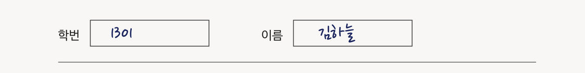
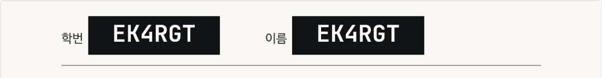
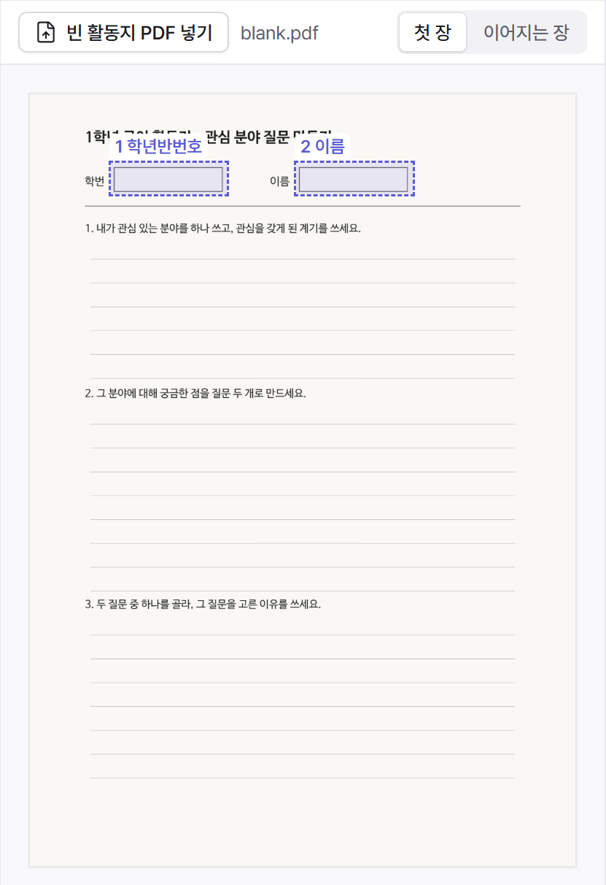
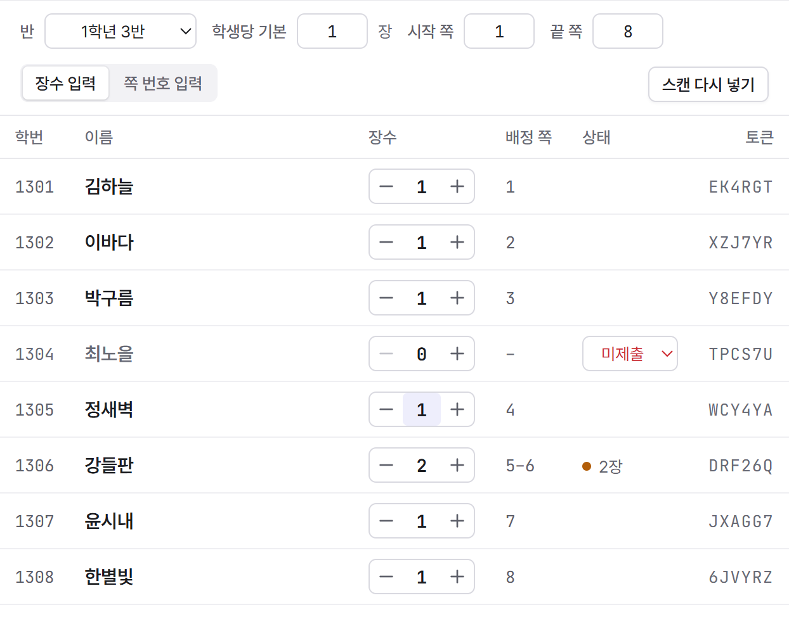
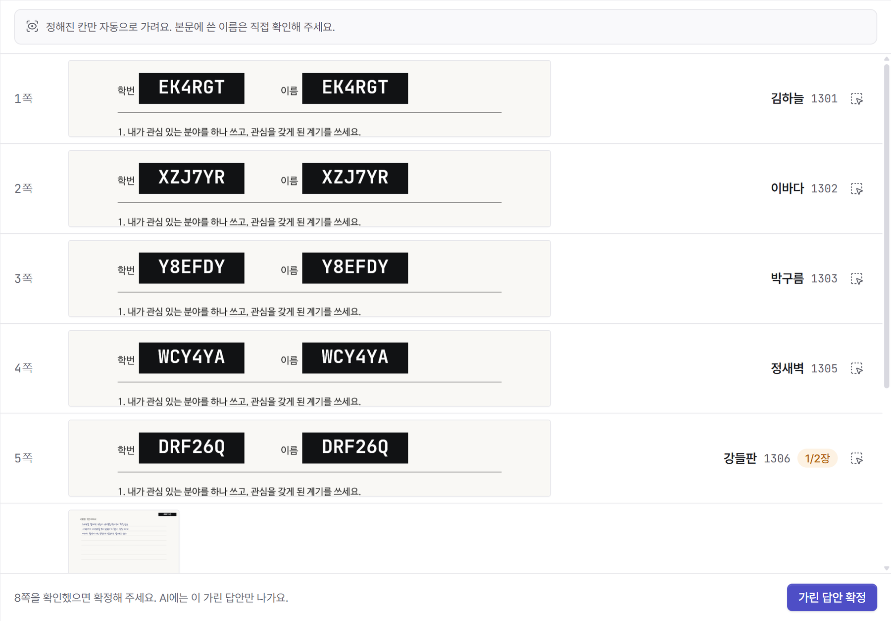
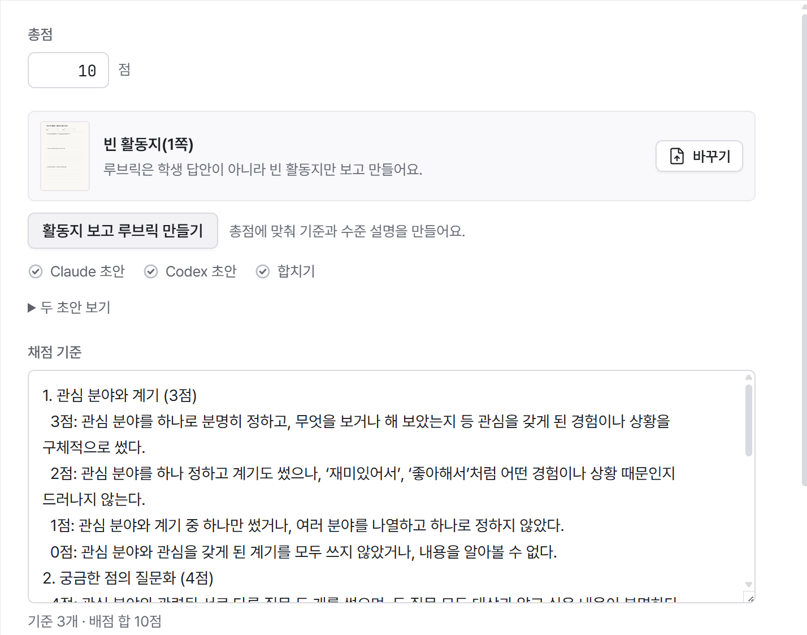
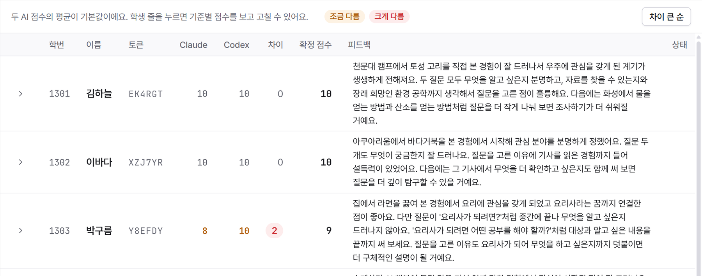

# 안심 활동지

학생 활동지는 가린 다음에 AI에게 보내요.

안심 활동지는 Windows용 휴대용 앱이에요. 번호순으로 스캔한 반 전체 활동지 PDF를 학생별로 나누고, 학번과 이름 칸을 가린 자리에 학생마다 정해진 6글자 토큰을 찍어요. AI(Claude·Codex)는 이 가린 답안만 받아 채점하고 피드백을 써요. 선생님이 확인한 점수는 토큰으로 학번을 찾아 구글 시트의 그 학생 줄에 붙어요.

| 원본 스캔 | AI가 받는 것 |
|---|---|
|  |  |

이 페이지의 화면은 모두 가짜 데이터(지어낸 학생과 답안)로 찍었어요.

## 내려받기

**[안심 활동지 최신판 내려받기 (ansim-worksheet-portable.exe)](https://github.com/riedle03/ansim-worksheet/releases/latest/download/ansim-worksheet-portable.exe)**

- Windows 10·11(64비트)용이에요. 파일 크기는 약 180MB예요.
- 설치하지 않아요. 내려받은 파일을 바로 실행해요. 관리자 권한도 필요 없어요.
- 처음 열 때 "Windows의 PC 보호" 창이 뜨면 **추가 정보 → 실행**을 누르세요. 코드 서명을 하지 않은 앱이라 뜨는 창이에요.
- 열 때마다 임시 폴더에 풀리느라 첫 화면까지 15초 안팎 걸려요.
- 바탕화면이나 문서 폴더처럼 늘 두는 곳에 두고 쓰세요. 새 판으로 바뀔 때 그 자리의 파일이 바뀌어요.

판마다 바뀐 점은 [릴리스](https://github.com/riedle03/ansim-worksheet/releases)에 적어요. 릴리스 화면에서는 맨 위의 `ansim-worksheet-portable.exe`만 받으면 돼요. 그 아래 Source code 두 개는 GitHub가 저절로 붙이는 저장소 묶음이라 안내 문서만 들어 있어요.

## 하는 일

과제 하나를 다섯 단계로 처리해요.

| 단계 | 하는 일 |
|---|---|
| ① 양식 | 빈 활동지 PDF에 가릴 칸(학번, 이름)을 한 번 그려요. 저장해 두고 다른 과제에도 써요. |
| ② 반별 분할 | 반마다 번호순으로 스캔한 PDF를 넣고 학생별 장수만 고쳐요. 결시·미제출은 0장, 두 장 낸 학생은 2장. 장수 합계가 쪽 수와 다르면 나누지 않고 멈춰요. 손글씨는 읽지 않아요. |
| ③ 확인 | AI가 받을 화면을 먼저 봐요. 정해진 칸은 자동으로 가리고 토큰을 찍어요. 본문에 쓴 친구 이름 같은 것은 직접 보고, 쪽마다 칸을 더 가릴 수 있어요. |
| ④ AI 채점 | 총점만 넣으면 Claude와 Codex가 빈 활동지를 보고 루브릭 초안을 따로 만들고, Codex가 둘을 합쳐요. 그다음 두 AI가 가린 답안을 따로 채점하고 피드백을 써요. |
| ⑤ 결과 확정 | 기준마다 두 AI 점수의 평균이 기본값이에요. 점수가 갈린 학생은 색으로 드러나요. 고친 뒤 **시트에 확정**을 누르면 구글 시트의 과제 탭에 기준별 점수와 피드백이 붙어요. |

**① 양식** — 가릴 칸을 한 번 그려 두면 같은 활동지에 계속 써요.

**② 반별 분할** — 결시한 학생은 0, 두 장 낸 학생은 2로 바꾸면 그 뒤 학생의 쪽이 다시 맞춰져요.

**③ 확인** — 오른쪽 이름과 학번은 선생님 화면에만 보여요. AI에는 왼쪽의 가린 답안만 나가요.

**④ AI 채점** — 루브릭은 학생 답안이 아니라 빈 활동지만 보고 만들어요. 배점 합이 총점과 맞는지는 앱이 확인해요.

**⑤ 결과 확정** — 학생 줄을 누르면 기준별 점수를 보고 고칠 수 있어요.

학기 말에 학생별 세특 초안을 쓰는 기능은 다음 판에서 더할 예정이에요.

## 처음 한 번 준비할 것

### 1. 명단 구글 시트

1. 구글 시트를 새로 만들고 탭 이름을 `명단`으로 바꿔요.
2. 첫 줄에 `학번`, `이름`, `토큰`, `메모`를 차례로 적어요.
3. 둘째 줄부터 학번과 이름을 넣어요. 학번은 `1101`처럼 네 자리나 `10101`처럼 다섯 자리로 적어요. 토큰 칸은 비워 두면 앱이 채워요.

한 학생의 토큰은 그 학년도 내내 같아요. 토큰 칸을 지우거나 고치지 마세요.

### 2. 구글 클라이언트 파일 (선생님마다 직접 만들어요)

이 앱에는 공용 구글 연결이 들어 있지 않아요. 선생님 계정의 시트에만 닿도록, 선생님이 만든 연결 파일을 넣어 써요.

1. [Google Cloud 콘솔](https://console.cloud.google.com/)에서 프로젝트를 하나 만들어요.
2. **API 및 서비스 → 라이브러리**에서 **Google Sheets API**를 사용 설정해요.
3. **Google 인증 플랫폼**(예전 이름 **OAuth 동의 화면**)에서 앱 이름을 정하고 사용자 유형을 골라요. 학교 Google Workspace 계정이면 **내부**를 고르세요. 개인 Gmail 계정이면 **외부**로 만들고 테스트 사용자에 본인 주소를 넣어요. 이때는 일주일쯤마다 다시 로그인해야 할 수 있어요.
4. **클라이언트**(또는 **API 및 서비스 → 사용자 인증 정보 → OAuth 클라이언트 ID 만들기**)에서 애플리케이션 유형을 **데스크톱 앱**으로 고르고, 만든 뒤 JSON 파일을 내려받아요.
5. 안심 활동지를 열면 나오는 **처음 한 번만 연결해요** 화면에서 이 JSON 파일을 넣고, 구글 로그인을 하고, 명단 시트 주소를 넣어요.

앱이 구글에 요청하는 권한은 구글 시트 읽기·쓰기 하나예요. JSON 파일과 로그인 정보는 이 PC에 암호화해 둬요.

### 3. AI 연결 (채점할 때만)

- [Claude Code](https://github.com/anthropics/claude-code)와 [Codex CLI](https://github.com/openai/codex)를 설치하고, 터미널에서 `claude`와 `codex`를 한 번씩 실행해 로그인해요.
- 앱은 API 키를 쓰지 않아요. 선생님이 로그인한 계정(구독)으로 채점하고, 사용량도 그 계정에서 빠져요.
- 둘 중 하나만 있어도 그 AI로 채점할 수 있어요. **설정 → AI 연결**에서 확인해요.
- CLI를 쓸 수 없으면 ④에서 **AI용 묶음**(가린 답안 PDF와 지시문)을 저장해 AI 서비스에 직접 올리고, 받은 결과표(xlsx·CSV)를 ⑤에서 가져와도 돼요.

## 무엇이 어디로 가나요

| 무엇 | 어디로 |
|---|---|
| 원본 스캔 PDF | 선생님 PC에만 있어요. |
| 가린 답안 이미지와 토큰, 빈 활동지, 채점 기준 | 채점할 때 선생님 PC의 Claude Code·Codex CLI를 거쳐 Anthropic·OpenAI로 가요. |
| 명단(학번·이름·토큰), 장수·상태, 확정 점수와 피드백 | 선생님의 구글 시트 |
| 앱 판 번호 확인 | 앱을 열 때 GitHub에 최신 판을 한 번 물어요. |

- 앱 자료(양식, 과제, 채점 결과, 암호화한 로그인 정보)는 `%APPDATA%\안심활동지`에 있어요. AI용 묶음은 기본으로 `문서\안심활동지`에 저장해요.
- 정해진 칸만 자동으로 가려요. 본문에 쓴 이름이나 서명은 ③에서 직접 확인해 주세요.
- 토큰과 학번을 잇는 표는 선생님 시트에 있어요. 그래서 가린 답안은 익명 자료가 아니라 가명처리한 자료예요.
- AI 채점 결과는 초안이에요. 선생님이 ⑤에서 확인하고 확정한 것만 시트에 들어가요.

## 새 판으로 바뀌는 방법

- 앱을 열 때마다 새 판이 있는지 확인해요. 있으면 실행 파일 옆에 `안심활동지-update.exe`로 받아 두고, 사이드바 아래에 **지금 다시 시작**이 떠요.
- 누르면 새 판으로 다시 열려요. 그냥 닫으면 닫힌 뒤에 바뀌어 있어요.
- PC 보안 설정으로 PowerShell 스크립트가 막혀 있으면 저절로 바뀌지 않아요. 그때는 같은 폴더의 `안심활동지-update.exe`를 실행하거나, 위 링크에서 새로 내려받으세요.

## 만든 사람

이대형 · [네이버 블로그](https://blog.naver.com/edutech-lab)

이 저장소에는 실행 파일과 안내만 있어요.
